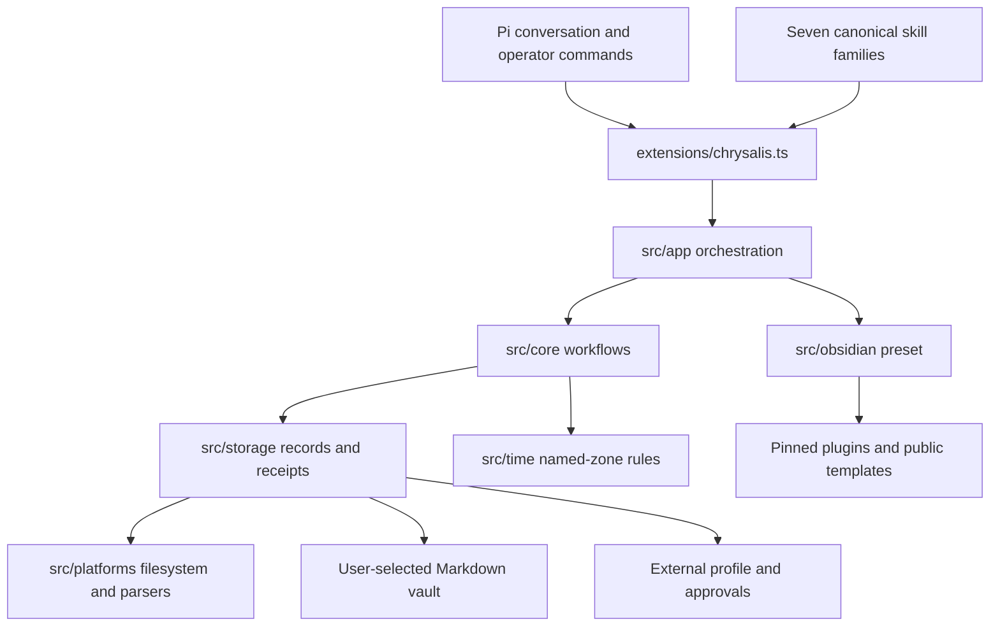
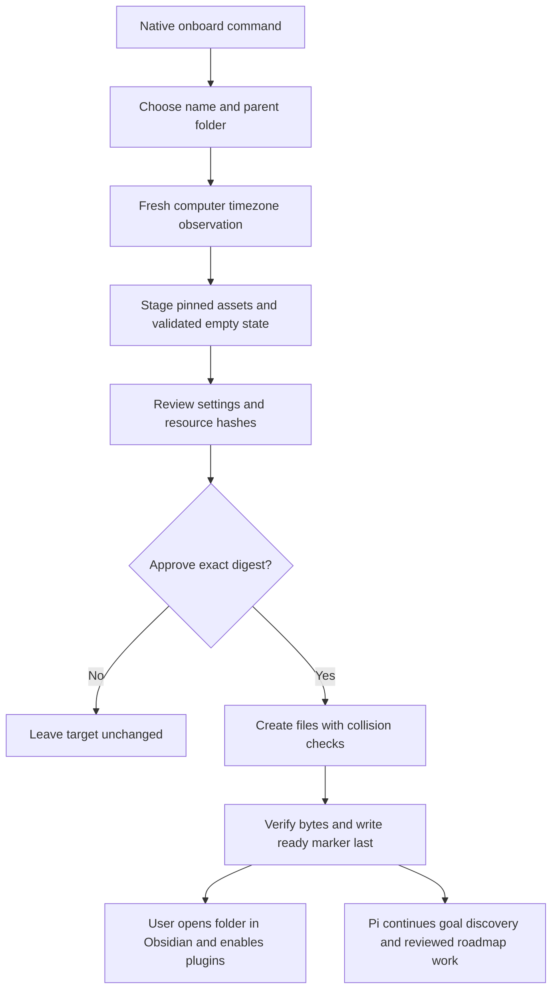
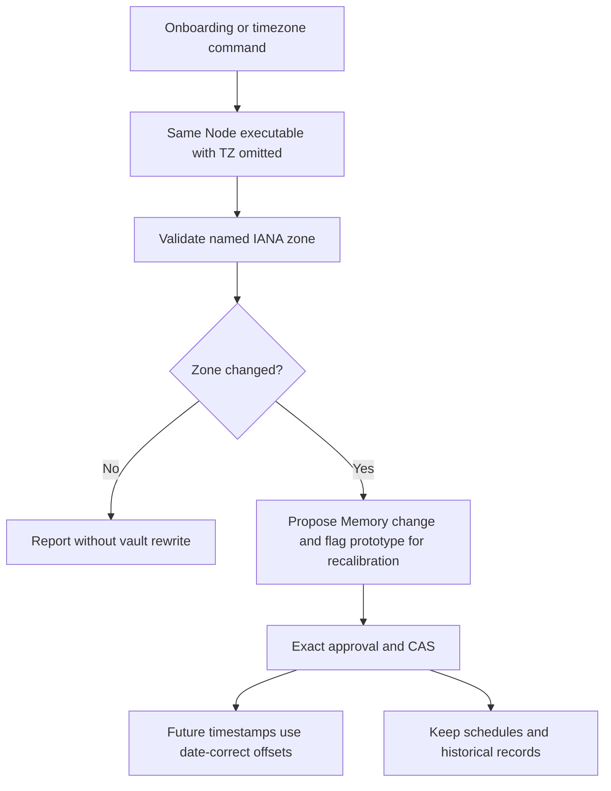

# Architecture

The installed package, user vault and external local profile are separate directories. The user chooses the vault folder name. The package identity is always chrysalis. No runtime is inferred from the current directory.

## Package layers

extensions/chrysalis.ts registers Pi tools and operator commands. src/app coordinates onboarding, timezone setup and 30 allowlisted operations. src/core owns deterministic workflows; src/storage owns Markdown/schema access, selected roots and receipts. src/platforms owns filesystem, environment observations and bounded processes. The core imports no Pi SDK. The field registry supplies task schema, native mapping and custom defaults.
Schemas use schema.value for validation; collection paths are fixed and shallow, without a recursive
query/default-filling engine. See the [operation API](docs/operations.md).

## Prepared vault

Onboarding builds external staging with complete resource hashes and settings for review. Approval binds that digest, destination and stable vault ID. Application refuses collisions, verifies all files and writes the ready marker last. Interrupted setup resumes only its reviewed scope. Repair restores eligible missing resources only when current bytes match the original setup receipt.
It preserves edits and cannot reset Memory or the roadmap; it is not a vault resource upgrade.

| Collection | Authority |
|---|---|
| System/Memory.md | Preferences, timezone, learning and private bindings |
| System/Life-Roadmap.md | Chosen goals, milestones and pillar taxonomy |
| Projects/&lt;id&gt;/Roadmap.md | Complete deliverable ledger |
| TaskNotes/Tasks and TaskNotes/Archive | Tasks with native projects relationships |
| Slipbox and Sources | Atomic knowledge and evidence provenance |
| Daily | Focus blocks, native calendar timeblocks, notes and sessions |
| Attachments/Originals | Original bytes and relative links |
| Environments | Reviewed observations with neutral aliases |
| _types, _templates and TaskNotes/Views | Generated schemas, templates and projections |

## Mutation boundary

Version 2 proposals contain complete post-images, raw revisions, root/ID bindings and schema/Memory/roadmap dependency hashes. Approval is absent from model operations. Application revalidates policies, atomically replaces individual files, verifies post-images and records resumable receipts externally. Local locks coordinate cooperating writers; a batch is not a distributed transaction and another editor can still race a final check.

The life policy permits canonical skill reads and chrysalis operations. General executors, web research, external memory tools and arbitrary reads/writers require a separate session.
The shared operation API lives inside the readable skill root. This policy is not an OS sandbox.

## Time context

Detection reads the computer setting. It does not infer geographical location or change OS settings. New timestamps use explicit offsets; UTC serializes as +00:00. Daily records retain their planning zone. Native floating dates/times keep their date/wall-time meaning and are never rewritten simply because the zone changes.

## Portability

Future adapters call the operation module with explicit roots, cancellation, canonical skills and an equivalent operator boundary. No daemon or parallel task database is required. Static capability bindings keep ingestion, location, routing, map projection and observed commitments separate. TaskNotes owns Calendar identifiers and history.

See [runtime](contracts/agent-runtime.contract.md), [ingestion](contracts/ingestion-input.contract.md) and [capabilities](contracts/integration-capabilities.contract.md).
