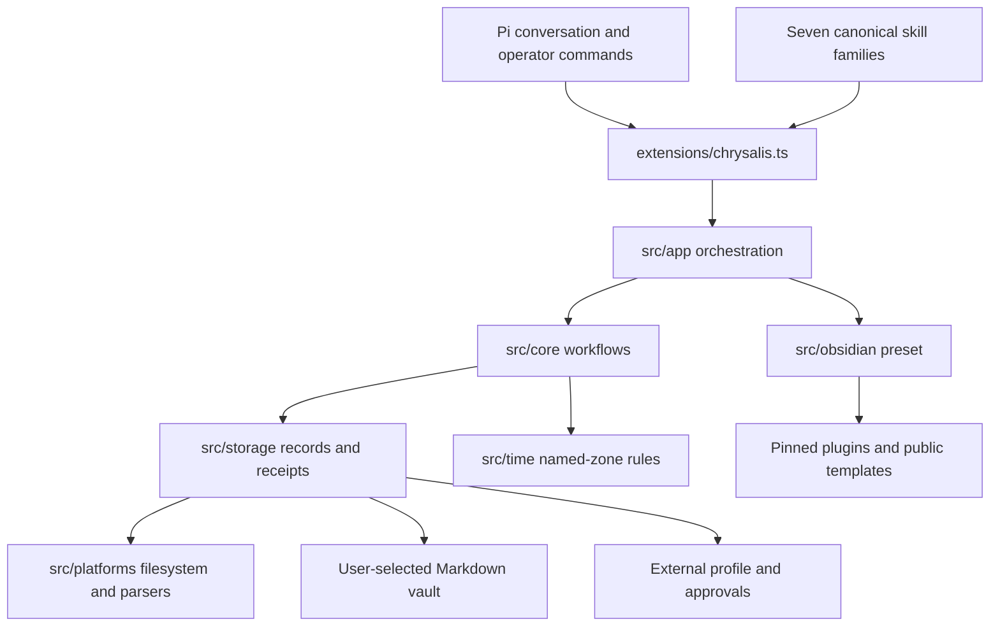
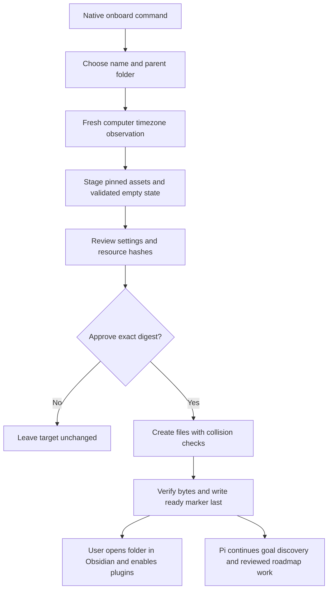
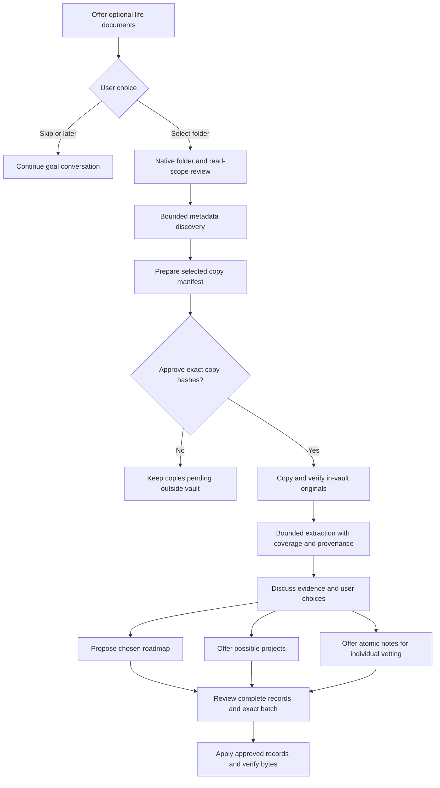
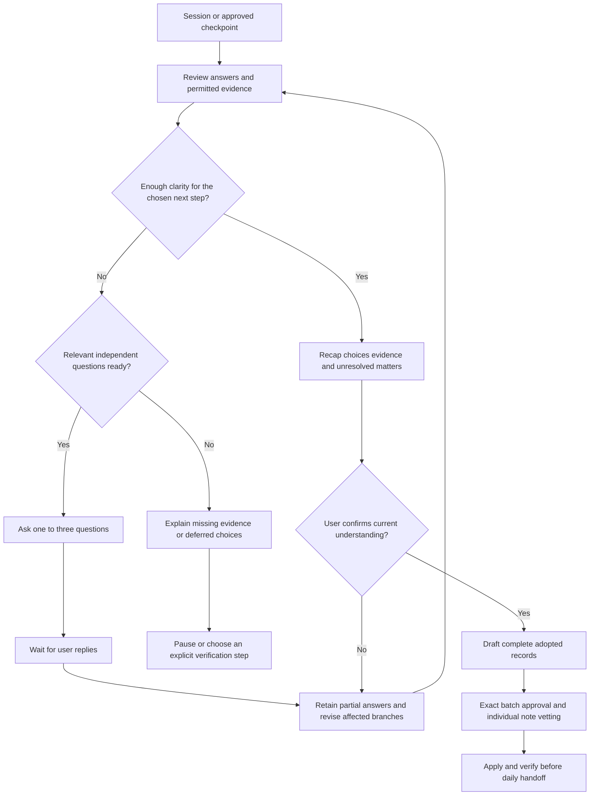
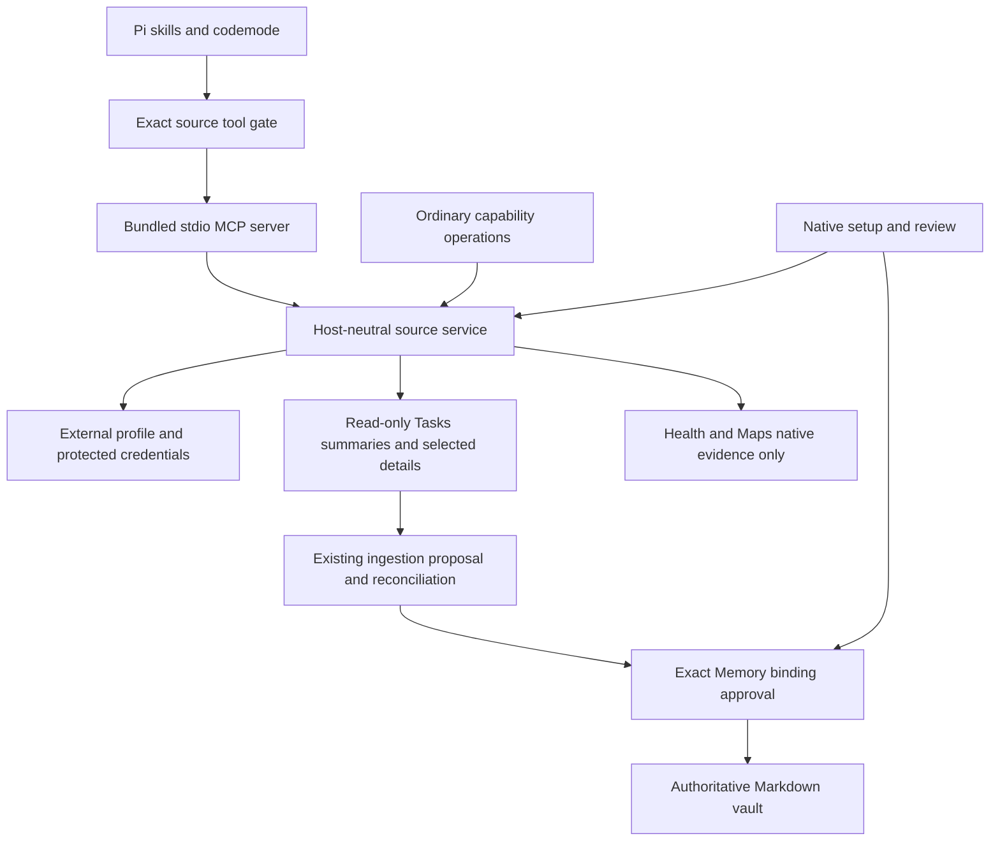
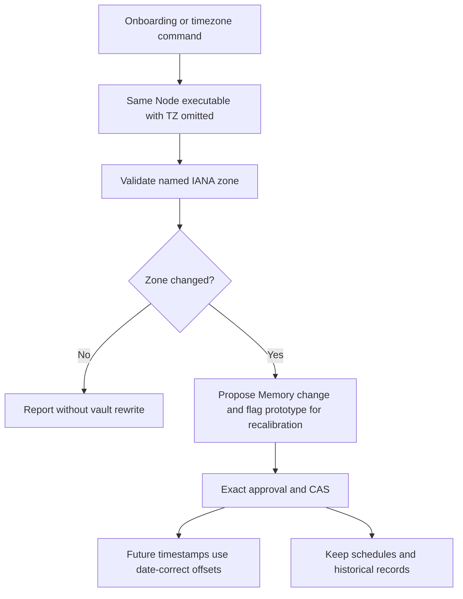

# Architecture

The installed package, user vault and external local profile are separate directories. The user chooses the vault folder name. The package identity is always chrysalis. No runtime is inferred from the current directory.

## Package layers

extensions/chrysalis.ts registers Pi tools and operator commands. src/app coordinates onboarding, timezone setup and 36 allowlisted operations. src/core owns deterministic workflows; src/storage owns Markdown/schema access, selected roots and receipts. src/platforms owns filesystem, environment observations and bounded processes. The core imports no Pi SDK. The field registry supplies task schema, native mapping and custom defaults.
Schemas use schema.value for validation; collection paths are fixed and shallow, without a recursive
query/default-filling engine. See the [operation API](docs/operations.md).

## Prepared vault

Onboarding builds external staging with complete resource hashes and settings for review. Approval binds that digest, destination and stable vault ID. Application refuses collisions, verifies all files and writes the ready marker last. Interrupted setup resumes only its reviewed scope. Repair restores eligible missing resources only when current bytes match the original setup receipt.
It preserves edits and cannot reset Memory or the roadmap; it is not a vault resource upgrade.

| Collection                                                | Authority                                                        |
| --------------------------------------------------------- | ---------------------------------------------------------------- |
| System/Memory.md                                          | Preferences, timezone, learning and private bindings             |
| System/Life-Roadmap.md                                    | Chosen goals, milestones and pillar taxonomy                     |
| Projects/&lt;id&gt;/Roadmap.md                            | Complete deliverable ledger                                      |
| TaskNotes/Tasks and TaskNotes/Archive                     | Tasks with native projects relationships                         |
| Slipbox and Sources                                       | Atomic knowledge and evidence provenance                         |
| System/Knowledge-Index.md and Knowledge-Log.md            | Reviewed knowledge inventory and append-only compilation journal |
| System/Knowledge-Answer-&lt;timestamp&gt;-&lt;slug&gt;.md | Explicit point-in-time answer snapshots citing atomic notes      |
| Daily                                                     | Focus blocks, native calendar timeblocks, notes and sessions     |
| Attachments/Originals                                     | Original bytes and relative links                                |
| Environments                                              | Reviewed observations with neutral aliases                       |
| \_types, \_templates and TaskNotes/Views                  | Generated schemas, templates and projections                     |

## Optional document-assisted onboarding

Conversation offers a folder of life documents early; skipping or deferring does not block setup.
The native documents command authorizes one explicit external folder, disjoint from package,
vault and execution state. src/core/documents.ts handles bounded metadata discovery and inert
selected-copy manifests. A separate exact operator receipt authorizes copies into
Attachments/Originals/Onboarding/<folder-id>. Raw hashes, destination collisions and authorization
identity are rechecked; source files remain untouched. Originals and source/knowledge records
have separate approval boundaries. Unsupported formats remain explicit deferred evidence.
Markdown imports bind safe TaskNotes/Dataview settings hashes and recheck them before writes.
Fresh presets exclude original storage from TaskNotes. Regular-file/nonblocking reads reject
special files and allocate from actual bounded sizes rather than a fixed maximum buffer.
See the [life-document procedure](skills/chrysalis-knowledge/references/life-documents.md).

## Conversational onboarding decisions

The knowledge skill's [decision procedure](skills/chrysalis-knowledge/references/onboarding-decisions.md)
tracks a scoped decision_ledger with prerequisites, evidence, answers and statuses. Shared
constraints can support several branches. Pi asks one to three ready independent questions per
round, retains partial answers and reopens only affected decisions after changes. Missing facts
delay dependent branches; skipping/deferment never supplies an assumed answer. The procedure
uses Pi conversation and ordinary reviewed System/Onboarding.md data, without a separate engine
or operation. Conversational shared_understanding confirmation precedes adopted record proposals
and remains separate from exact operator approval. Unsaved discussion stays in the Pi session.
Decision readiness and recap meaning are checked by the agent/user; system-state data remains
extensible. These instructions do not add automatic dependency-graph validation or establish
model-conversation acceptance. Native mutation approvals are enforced by the existing backend.

## Mutation boundary

Version 2 proposals contain complete post-images, raw revisions, root/ID bindings and schema/Memory/roadmap dependency hashes. Approval is absent from model operations. Application revalidates policies, atomically replaces individual files, verifies post-images and records resumable receipts externally. Local locks coordinate cooperating writers; a batch is not a distributed transaction and another editor can still race a final check.

Any proposal creating atomic notes requires separate complete-Markdown review and confirmation of
each new note before final batch approval. Backend receipts bind the note path/post-image hashes.
Knowledge compilation additionally binds observed knowledge revisions and includes its lint report,
generated index and append-only journal in the exact proposal. Search/lint are read-only; answer
snapshots are explicit new reviewed System records. See [knowledge design](docs/knowledge-design.md)
for the compilation/query flowchart, upstream adaptation and bounded-storage limits.

The life policy permits canonical skill reads, chrysalis operations and gated package-source codemode. General executors, web research, external memory tools and arbitrary reads/writers require a separate session.
The shared operation API lives inside the readable skill root. This policy is not an OS sandbox.

## Source modules

The package-owned MCP server is a thin transport over src/integrations/service.ts. Provider
modules share normalization with ordinary named-capability operations; none imports Pi. Native
setup stores protected credentials externally and proposes nonsecret Memory bindings. Both the
native profile and the approved binding must agree. extensions/sources.ts reuses upstream Pi
codemode and MCP implementations with explicit session configuration and model helpers disabled.
The life gate validates effective registration, tool origin and schemas, including nested calls.
Health/Maps content is native-only; their model paths return non-content readiness without reads.
See [source setup and limits](docs/integrations.md).

## Time context

Detection reads the computer setting. It does not infer geographical location or change OS settings. New timestamps use explicit offsets; UTC serializes as +00:00. Daily records retain their planning zone. Native floating dates/times keep their date/wall-time meaning and are never rewritten simply because the zone changes.

## Portability

Future adapters call the operation module with explicit roots, cancellation, canonical skills and an equivalent operator boundary. No daemon or parallel task database is required. Static capability bindings keep ingestion, location, routing, map projection and observed commitments separate. TaskNotes owns Calendar identifiers and history.

See [runtime](contracts/agent-runtime.contract.md), [ingestion](contracts/ingestion-input.contract.md) and [capabilities](contracts/integration-capabilities.contract.md).
