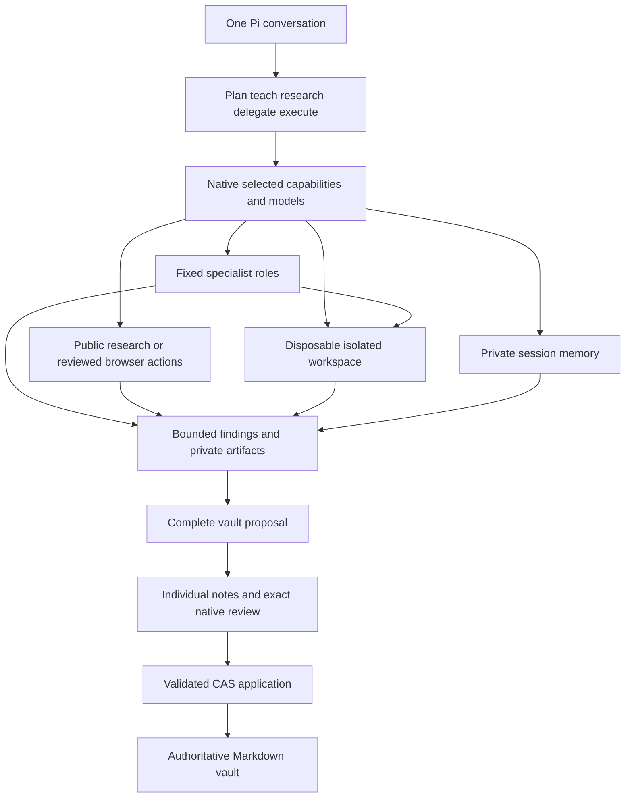

# Assistant capabilities

chrysalis combines planning, teaching, research and execution in one Pi conversation. Its vault
remains authoritative Markdown. Shell commands, memory summaries, child results and browser pages
are context or private work products; they cannot approve vault records.

First vault onboarding offers optional assistant setup. Choose Later to continue with the vault
and conversation alone. Return with `/chrysalis assistant-setup`. Optional features default off.
Model choices are native controls, not model-issued tool arguments.

| Native command                               | Purpose                                                                            |
| -------------------------------------------- | ---------------------------------------------------------------------------------- |
| `/chrysalis models`                          | Shared background model or individual role routes, thinking and usage preset       |
| `/chrysalis capabilities`                    | Enable/disable one optional capability; repeat for other choices                   |
| `/chrysalis workspace`                       | Review an isolated project workspace and networking policy                         |
| `/chrysalis runner-setup`                    | Open a reviewed Debian/Ubuntu sudo installer in a tmux window                      |
| `/chrysalis browser open`, `close`, `status` | User-controlled visible managed browser; model automation pauses during manual use |
| `/chrysalis assistant-status`                | Inspect configured prerequisites and explicit verification limits                  |
| `/chrysalis usage`                           | Session work reservations and reported optional-provider usage                     |
| `/chrysalis develop prepare`                 | Select a private source copy for development                                       |
| `/chrysalis develop review <id>`             | Review exact reusable source changes and promote with revision checks              |
| `/chrysalis artifact inspect <handle>`       | Inspect a private generated image and provenance                                   |
| `/chrysalis artifact adopt <handle>`         | Separately review copying that image into vault originals                          |
| `/chrysalis recovery`                        | Locate retained workspace-conflict candidates without overwriting                  |
| `/chrysalis worker-reconcile`                | Release an exact reviewed lease only after recorded child exit                     |
| `/chrysalis retention`                       | Review deletion of listed private artifacts/lessons older than 30 days             |

## Models and overhead

The background-model picker keeps the selected row visible in a terminal-sized window.
Type a provider or model prefix to jump to its first match; Backspace edits and Ctrl+U clears.
Use Up/Down to move, Page Up/Page Down to page, Home/End to reach the ends,
Enter to choose and Escape to cancel. Resizing preserves the current selection.
Choosing a model still precedes the separate native route review; cancellation saves no routes.

Choose authenticated chat models from Pi's public registry. Main chat uses Pi's normal model
selection. Memory and each specialist retain explicit native routes. Memory streams use the
parent registry directly; child processes use a fixed bounded route to the same parent runtime.
Provider source, private account implementations, hooks, tools and credentials are not copied
into children. No private adapter declaration or provider-specific wrapper is required.
See [provider propagation and limits](compatibility.md). Economical defaults use one concurrent
optional job, eight specialist turns, a bounded brief/result and 24 session work reservations.
Memory observation/reflection/dropper roles are independently selectable. Less thinking and a
smaller appropriate model can reduce overhead; price and quality depend on the selected provider.
Unavailable routes pause the work. There is no silent upgrade to the main model or paid API.

Specialists reserve their maximum turns until completion. Browser actions reserve one work unit.
Memory reserves each actual provider stream until completion/cancellation, caps output at 1,500
tokens per turn and uses a 60-second stream timeout. Work reservations are not a billed-token
quota. Main-model usage and provider-internal retries are outside this counter. Unknown token
usage is reported as unknown. Browser search/extraction and diagram rendering add no summary model.

## Learning and memory

The learning skill adapts explanation depth, checks understanding optionally and links learning
to potential projects. Questions accept free text, skip and later; quizzes have stable shuffled
choice IDs and deterministic grading. The authored answer key is not independent factual proof.
During onboarding, teach unfamiliar choices and offer small trials before proposing goals.

Lesson capture is opt-in, bounded and private. It retains focused text and quiz responses rather
than raw tool streams. New captures stop at the 100-file bound; use native retention review to remove eligible old entries. Durable lesson
notes, roadmap choices and every new atomic note still require their normal native review.

The pinned Blackhole engine supplies current-session recall/compaction and optional observational
workers. Worker routes are explicit; fallback routes and environment overrides are disabled.
Private ledgers and exports stay outside source/vault. Sharing Pi's session directory preserves
history but does not automatically inject all other conversations into a new session. Conversation
memory is not authoritative vault state. Use reviewed vault records for durable chosen decisions.

Mermaid diagrams receive a bounded Unicode preview and inert SVG artifact. Direct SVG accepts only
restricted geometry/text; scripts, external resources and encoded URI escapes are rejected.
Rendering success does not prove visual inspection. Inspect the actual image before adopting it.
Image adoption copies only an original to `Attachments/Originals/Generated`; related Source,
roadmap and atomic-note records have separate approvals.

## Execution and development

Execution currently requires accepted Linux ARM64/x64, Bubblewrap, systemd user services and tmux
for managed setup/specialists. Base vault operations remain available on other supported hosts.
The runner has no permissive host-shell fallback. The native setup installer supports Debian/Ubuntu
with systemd already enabled; other distributions require equivalent operator setup.

Native workspace selection rejects vault/source/state overlap, known credential roots, links and
special files. Each command uses a regular-file snapshot in a disposable namespace, not original
writable host inodes. Git/configuration secrets and environment files are excluded. External
networking and host IPC are blocked; an optional fresh loopback namespace supports local tests.
There is no general network-enabled shell mode. Research uses the separate controlled browser.

Limits include 64 MiB workspace, 32 MiB scratch, 512 MiB aggregate memory, 64 tasks, one CPU,
bounded command input/output and timeout/cancellation. The host merges regular-file results only
after checking original raw revisions. Conflicts retain private candidates. Empty directory and
mode-only changes are not a complete filesystem synchronization service. Multi-file merge is not
a distributed transaction. Native guardrail confirmation handles risky command intent; permission
never expands the namespace's immutable vault/credential boundary.

Specialist roles are fixed: researcher has public research and read-only workspace inspection;
reviewer has read-only inspection; diagram-maker adds private visual artifacts; worker alone can
write the workspace. A worker owns a parent/child writer lease for its lifetime. The child PID
and kernel start identity are bound at startup. Parent death never automatically releases ownership.
Native reconciliation releases only a verifiably exited child; uncertain startup remains blocked. A minimal programmatic Pi child host verifies extension loading, bindings and policy hashes before
any model prompt, with fatal startup failures and a hard lifetime bound. Children cannot
approve records, modify policy, spawn children or select alternate tools/models/roots. Task status
is retained privately. After a parent restart, old running status is explicitly uncertain; launch
a new bounded brief rather than silently resuming a stale policy envelope.

Source development prepares an external copy of reusable package files. Review shows complete
changed text, deletions, before/after hashes and the source privacy check. Native promotion checks
live revisions, retains recovery bytes and disables execution until reload and workspace review.
Already-loaded runner helper bytes are sealed per run; changed source policy requires reload.
Promotion does not run the full suite or commit/push. Follow the development verification workflow
before publication. Installing dependencies or running arbitrary project scripts needs a separately
prepared workspace; private credentials and general host access are not granted by this feature.

## Browser, search and optional media

Native capability setup installs pinned Playwright and full Chromium outside source, reusing the
matching pack-owned browser binaries. Optional npm dependencies use committed complete lockfiles and npm ci. It loads a hash-pinned uBlock Origin Lite extension. The optional
browser download is large; no browser or media pack is downloaded for basic vault use.

Public research uses a separate anonymous profile, public HTTPS only, bounded visible text/links
and bounded source links. Primary-source selection and citation quality remain the agent's research responsibility. It has no account interaction permission and no extra summarizer.
The automation profile is private and persistent. Navigation, click, fill and screenshots each require native
action approval, because GET requests can also change accounts. Non-GET requests need additional
native permission. Generic fill cannot enter password fields; native-approved saved-login filling
uses the private [password store](passwords.md). Tools cannot evaluate JavaScript, export cookies,
choose arbitrary profiles or mutate vault files. Sign-in uses user actions or exact native saved-login selection; password values are never tool parameters. `/chrysalis browser open` opens a visible window on
the Linux host for manual use after native confirmation; it requires GUI access there. Manual page
actions permit their requests while model automation is blocked. Close it before automated work.
The command does not enable Gemini model access or verify an account.

The broker validates all DNS addresses and pins the chosen public address for each HTTPS request.
Private/special destinations, WebSockets and direct browser traffic are blocked. Health, Maps,
Tasks and Calendar service destinations remain behind their reviewed integration paths. Native
Health/Maps evidence cannot be acquired through ordinary browser tools. Queries should not disclose
private document text, credentials or unnecessary identifiers. Pages remain untrusted evidence.

The optional media pack prepares the pinned web-access Gemini client only. Gemini Web/YouTube
authentication and real video acceptance are deferred. The adapter accepts canonical public YouTube
URLs, keeps cookies internal, returns bounded redacted results and has no paid/provider fallback.
The model tool reports deferred readiness until separate native account acceptance is implemented
and performed. No account settings are changed automatically.

## Acceptance boundaries

Synthetic tests cover approvals, namespace isolation, Windows interop refusal, bounded I/O,
leases, memory stream lifetime, chosen routes, inert diagrams and exact original adoption. Actual
Chromium acceptance uses synthetic page content/cookies and verifies persistence and adblock loading.
Actual Pi SDK child loading is tested without model calls. Narrow model cases also cover a teaching
onboarding reply with an unchanged synthetic vault and one completed isolated worker task. These
do not establish quality across all teaching/specialist scenarios, real Google login/video ingestion,
other OS execution runners or physical Obsidian rendering. Read current [verification status](../STATUS.md) before relying on a capability.
