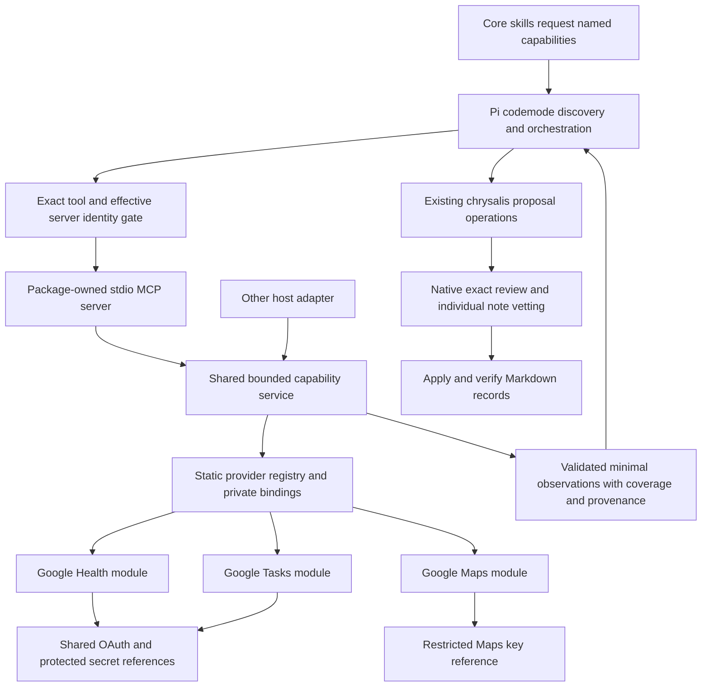
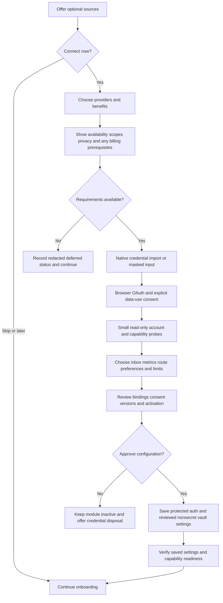

# Modular source integrations through Pi codemode

The modular package implementation has been delivered against this design. See [current status](../STATUS.md) and [source usage](integrations.md) for implemented behavior and acceptance limits. Authenticated account, physical UI and publication gates remain separate. The baseline below describes the starting point, not the current package.

Original design date: 2026-10-08. This document does not enable providers, collect credentials,
change runtime permissions or establish account acceptance. Preserve the current uncommitted
knowledge/document/onboarding work while implementing it.

## Intended result

Ship optional Google Tasks, Google Maps and Google Health modules inside the chrysalis Pi package.
Expose a small read-only MCP interface through Pi's built-in codemode. Core workflows request
provider-neutral capabilities; provider authentication and transport live outside those workflows.
Users can connect selected sources during onboarding or later, and can skip all integrations.

Use one package-owned local stdio MCP server with a static registry of independently enabled
provider modules. This keeps installation self-contained without requiring separate server
packages, a remote chrysalis service or a permanently running daemon. Another host can use the
same MCP server or call the underlying capability service. Only the Pi adapter depends on Pi.

The vault remains authoritative. Google Tasks is a quick capture surface that the user edits in
Google's application; chrysalis reads it and proposes local task notes. Google Health supplies
optional evidence for morning calibration. Maps supplies contextual travel estimates. Every
resulting vault mutation retains complete proposal review, exact operator approval and revision
checks. Every new atomic note still requires individual vetting.

## Verified starting point and provider constraints

Current source has 36 operations, a static adapter registry, private capability bindings and a
seven-family skill layout. integrations.status and capability already exist. Tasks currently
reads normalized snapshots/exports. Maps has opt-in live Places/Routes requests. Health is
deferred. Credential collection, OAuth and an MCP server are not implemented. The current
extensions/chrysalis.ts activates read/chrysalis_operation and blocks other calls: adding a
server alone would not make codemode or its nested tools usable.

Pi's documented codemode executes tool orchestration in a sandbox and returns the script's
chosen output. Tools can be discovered on demand. MCP calls return CallToolResult, so scripts
must examine isError and structuredContent. Small codemode store values persist in the session:
do not put secrets or raw health payloads there. See [Pi codemode](https://pi.dev/docs/latest/codemode).
The external dependency mirror for the pinned Pi 1.0.4 contains codemode documentation and
registerMcpServer types; actual native behavior still needs acceptance.

Pi supports extension-registered MCP servers with codemode exposure. Its tool hooks also cover
nested MCP calls. File-configured servers can override extension registrations; active tool
declarations alone do not constrain codemode reachability. Use explicit call policy and verify
effective server identity. See [Pi MCP](https://pi.dev/docs/latest/mcp).

Google currently states it is not onboarding new Health API projects. The legacy Fitbit API is
scheduled to stop functioning on October 30, 2026; do not build a new dependency on it. Health
implementation and synthetic fixtures can proceed, but live access requires an eligible project.
See [Google Health availability](https://developers.google.com/health).

Health scope grants can be partial. Start with sleep.readonly and add other bundles only for
implemented, user-selected features. See [Health scopes](https://developers.google.com/health/scopes).
Health setup requires a linked Health account and verification through users.getIdentity;
provider-approved OAuth client/redirect behavior must be confirmed before freezing that flow.
See [Health setup](https://developers.google.com/health/setup).

Google Tasks supplies pagination, updatedMin and completion/deletion flags; request only
tasks.readonly. A page of results is not a complete account inventory. See
[Tasks list](https://developers.google.com/workspace/tasks/reference/rest/v1/tasks/list).

Maps restrictions cover storage and attribution, not just API authentication. Pi transcripts,
codemode output, temporary files and reviewed schedule proposals are possible persistence sinks.
A short TTL does not itself grant a right to cache content. Preserve the existing restrictions on
provider-derived coordinates/routes until the intended uses are cleared against applicable terms.
See [Routes policies](https://developers.google.com/maps/documentation/routes/policies).

## Architecture

MCP is a thin transport over the capability service, not a second implementation of providers.
Move the live transport out of src/core/integrations.ts into the registry modules and have the
existing capability operation call the same service. Keep fixture transports explicitly separate
from account authentication. Retain useful ingestion/location normalization and record safeguards.

Proposed layout:

| Path                                           | Responsibility                                                         |
| ---------------------------------------------- | ---------------------------------------------------------------------- |
| src/integrations/contracts.ts                  | Capability inputs/results, coverage, readiness and retention policy    |
| src/integrations/registry.ts                   | Fixed module IDs and explicit workflow bindings                        |
| src/integrations/service.ts                    | Authorization, normalization, bounds and common dispatch               |
| src/integrations/providers/google-tasks.ts     | Read-only task lists/captures                                          |
| src/integrations/providers/google-maps.ts      | Places resolution and bounded route computation                        |
| src/integrations/providers/google-health.ts    | Eligible account checks and permitted health observations              |
| src/integrations/auth/google.ts                | Provider-approved browser authorization, refresh and revocation        |
| src/integrations/auth/secrets.ts               | Protected credential-store interface; no resolved values in results    |
| src/platforms/secret-store.ts                  | Platform credential-store implementations                              |
| src/mcp/server.ts                              | SDK-based stdio entrypoint and schemas over the shared service         |
| src/app/integrations.ts                        | Operator setup, activation, disconnection and reviewed binding changes |
| extensions/chrysalis.ts                        | Pi registration, operator UI and nested call policy                    |
| contracts/integration-capabilities.contract.md | Updated provider-neutral contract                                      |
| skills/chrysalis-integrations/references       | Setup, codemode recipes and provider-specific guidance                 |

Use the maintained MCP SDK rather than implementing the wire protocol. Pin dependencies and
include all required server files in the package archive. The server uses the selected Node
executable and an absolute package entrypoint; it runs only while needed by the host. Stdout is
MCP only. Sanitized diagnostics go to stderr. No runtime download commands or shell-built launches.

### Capabilities and initial tools

Keep location.resolve, routing.estimate and ingestion.discover/read. Add health.morning_context
as a read-only observation capability. Existing Drive/Calendar observations continue through the
same registry without implying new live support in this release. Bind capabilities by explicit
private instance IDs; adding a provider must not require changing morning or ingestion algorithms.

Use the MCP namespace chrysalis_sources, with the following proposed narrow tools:

| Tool                  | Capability/use                           | Required boundaries                                          |
| --------------------- | ---------------------------------------- | ------------------------------------------------------------ |
| integration_status    | Redacted readiness for enabled instances | No credential contents or account emails                     |
| list_task_lists       | User selection of an inbox               | Native account authorization; bounded results                |
| read_task_inbox       | Selected Tasks captures                  | Authorized list only; page/coverage and version evidence     |
| get_morning_context   | Selected sleep/optional activity summary | Consented metric bundles, date window and disclosure policy  |
| resolve_location      | location.resolve                         | Query/region only; explicit disambiguation                   |
| estimate_travel_times | Bounded routing.estimate batch           | Explicit endpoints, modes, time context and permitted output |

Publish input and output schemas with structuredContent. Each result carries schema_version,
capability, provider, instance alias, status, observed_at, relevant timezone, coverage, freshness,
provenance and a machine-readable usage/retention policy. Data is bounded and normalized; missing,
empty, partial, stale, denied, rate-limited and unavailable have distinct meanings. Sanitize
errors before both text content and structured content; never echo headers or credential values.

An observation reference is an opaque, short-lived server-managed handle bound to vault/profile,
instance, consent version and source revision. It is not a freely supplied path or URL. Expired
handles require a fresh read. Normalize provider times while preserving source timezone/offset
provenance. New chrysalis timestamps use the vault's named zone and date-correct explicit offsets.

## Guided setup and credential handling

Add /chrysalis integrations with guided setup plus status, test, reconnect and disconnect actions.
The initial onboard flow offers this after basic vault setup and can defer it without delaying
goal discovery. Reuse the decision ledger: provider choices precede credential instructions;
account/list choices wait for verified authorization. Ask at most three independent questions.

The walkthrough explains each provider's benefit, what leaves the computer, required scopes,
account/project setup and failure recovery. It supplies official console/documentation links and
the exact supported callback URI rather than asking the user to guess. Users can import their
downloaded credential JSON or enter a client ID, client secret or API key in native controls.
Client IDs are not secrets, but keep account-specific setup out of public source.

Secrets never pass through model tool arguments, chat, codemode, proposal text, vault Markdown or
Pi configuration literals. Implement a genuinely masked native input or direct credential-file
import; ordinary chat/input/editor controls are insufficient. Model-visible results show opaque
references and readiness only. Reject credential imports from source/vault; do not silently copy
the user's existing credential file into either directory.

Store secrets and refresh tokens in OS-protected storage: Windows Credential Manager, macOS
Keychain or Linux Secret Service behind one interface. Do not fall back to plaintext when that
backend is unavailable. Provide guided use of an approved protected external store/environment
reference for non-Health providers; Health remains disabled if its encryption requirements are
unmet. Credentials belong to a private profile outside package and vault and are resolved only by
the native operator/auth service and authorized provider process. Never put them in process argv.

Use separate provider auth records and explicit scope/account selection. Separate Google Cloud
projects are needed when independent remote revocation is required: revoking a Google grant
removes project-wide scopes and can invalidate tokens for other clients in that project. Track
the project/account relationship, show affected known integrations and warn about other clients
that chrysalis cannot enumerate before native approval of remote revocation. Existing eligible
Health projects can still be used with that shared-revocation limitation. See
[Google token revocation](https://developers.google.com/identity/protocols/oauth2/native-app#tokenrevoke).
Google's API OAuth occurs between the local provider service and Google; it is distinct from
authenticating to a remote MCP server and from Pi's model-provider credentials.
Use a maintained Google OAuth library, system browser,
state, PKCE where supported, a bounded loopback callback and validated redirects. Match the
provider-approved client type; do not assume a Tasks desktop client is valid for Health. See
[Google native OAuth](https://developers.google.com/identity/protocols/oauth2/native-app).

Save only nonsecret instance IDs, capability bindings, selected inbox IDs, feature preferences,
consent version and secret references through existing reviewed configuration proposals. Local
auth/config changes must also require native operator confirmation; the model cannot activate a
provider or enlarge scope. An authorized setup probe has its own narrow consent before active
workflow bindings exist. Cancellation leaves bindings inactive and offers local disposal of newly
stored credentials without deleting shared references. It does not silently revoke Google grants;
any remote revocation follows the project/account collateral review above. Reconnect and adding
scopes require fresh review; use the supported client flow rather than assuming incremental
authorization is available for installed clients.

Readiness separately records installed, configured, authorized scopes, authenticated, reachable
and verified, including when/how verification occurred. OAuth success alone is insufficient;
verify the requested capability and selected scope. Empty data can still prove authorized access.
Refresh on demand, serialize concurrent refreshes and atomically retain rotated tokens. Handle
testing-mode expiry, revocation and insufficient scope with actionable reconnect status. Local
disconnect stops the selected instance's access, invalidates its handles and offers removal of
unshared protected credentials without deleting authoritative vault records. Remote project-wide
revocation is a separately reviewed action; on success invalidate affected local grants and require
reauthorization, without claiming that local disconnection revoked Google's access. Retention/
deletion controls are part of setup, not deferred UI.

## Codemode and token consumption

Register the bundled server using pi.registerMcpServer with exposure codemode and concise trusted
descriptions. Use Pi's built-in codemode; do not install or build a replacement. Keep
chrysalis_operation and canonical skill reads available. Do not change the user's global tool
settings or activate unrelated servers. Choose the supported Pi minimum after the native proof.

Update the life-profile gate to admit built-in codemode orchestration and the exact approved
chrysalis_sources tools. Continue blocking shell, arbitrary files, unrelated MCP/resources and
model/classifier paths not included in the approved data-use policy. Test those paths explicitly;
do not claim the tool gate controls codemode's models API unless verified. If the host cannot
enforce a required disclosure boundary, keep sensitive capabilities unavailable.

Check every nested call independently. Verify the effective server registration, executable,
package entrypoint, profile binding and approved schemas before permitting calls; a matching name
or readOnlyHint is insufficient. Fail closed on a same-name file-configured override, replaced
tool/schema or ambiguous ownership. No wildcard permission for mcp\_\_\* and no resource endpoint
for secret files. Provider modules also enforce approved requests, independent of host policy.

Fetch only selected fields/windows at the provider. Normalize and aggregate in the provider
service, then let codemode join/filter independent observations and emit the needed summary.
Task detail is fetched only for selected candidates. Do not print entire payloads, accumulate
unbounded pages or rely on output truncation for privacy. Keep completeness, uncertainty, units,
provenance and per-provider failures in the reduced result. Handle both rejected promises and MCP
isError results. Await work; a failed script does not undo calls already made.

Ship short tested recipes for morning evidence, inbox capture and permitted travel queries.
Discover tools/schema on demand, retain only opaque IDs/cursors in allowed session state, and use
bounded parallelism for independent reads. Keep credential setup and exact operator review outside
codemode. Generic script generation does not replace backend bounds or record validation.

Initial engineering defaults, adjustable only through reviewed configuration: maximum 100 items
per Tasks page and 500 per invocation; at most 35 days of daily Health aggregates; maximum 20 route
pairs per invocation, four concurrent provider requests, one MiB decoded response per request and
a 30-second overall request deadline. These are product limits, not claims about provider quotas.
Validate them against each API and allow explicit narrowing/repeated bounded runs. Server-enforced
per-profile request budgets, cancellation and retries apply across codemode calls. Count billable
route elements/requests; a billing alert is not a hard spending limit.

Measure cold and warm runs with identical synthetic datasets and correct results: direct MCP
versus codemode, small versus large inputs, partial failure and pagination. Count all tool schema,
discovery, script, input/output and retry tokens, plus calls, bytes, latency and provider cost.
Report model/tokenizer, dataset and cache conditions. A proposed release target is at least 50%
median total model-context reduction on the large Tasks/Health fixtures with no coverage loss;
small requests may save nothing. Do not promise a universal percentage or cheaper provider usage.

## Workflow-specific implementation

### Google Tasks: reviewed one-way capture

Use tasks.readonly to list inbox choices and read only the user-selected lists. Default to active
captures, with explicit hidden/completed/deleted flags for reconciliation. Preserve date-only due
semantics; do not infer a scheduled time. Surface unsupported hierarchy/assigned-task/link semantics
instead of silently flattening meaningful relationships.

Reuse ingestion reconciliation and proposal/application. Identity is provider + private account
alias + list ID + task ID, with updated/etag and normalized observation digest. A normalized JSON
digest must not be advertised as an original-file raw SHA-256. Bind captured evidence to exact
proposals. Imported revisions and checkpoints advance only after approved, verified application;
reading or declining a proposal must not mark captures imported.

Repeated reads must not create duplicates. Preserve local edits, completion, schedules and
Calendar fields; changed source items with local conflicts require review. Deleted/absent items
never delete local task notes. Include page completeness and overlap when using incremental
watermarks so interrupted/partial runs do not lose captures. Show captured/imported/changed/skipped
counts so users understand why an item left in Google Tasks will not be imported repeatedly.
Do not complete, update, delete or move Google Tasks, and register no tools capable of doing so.

### Google Health: evidence for morning calibration

Initially read sleep duration/timing and coverage, with an optional simple recent baseline when
enough data exists. Activity/other metrics are later opt-in additions with implemented normalization
and additional read-only scopes. Do not request ECG, location, reproductive or unrelated bundles.
Handle linked-account failures, unsynced devices, missing/partial permissions, duplicate streams,
time-zone changes and late-arriving overnight sleep. Choose the reconciled source semantics from
the API and retain uncertainty instead of double-counting measurements.

Morning conversation can show the latest supported sleep observation and ask whether it reflects
the user's experience. The user still supplies actual wake time and energy; contradictory or stale
device readings never silently override them. Offer explainable adjustments for review without
inventing a clinical readiness score. Keep the deterministic planner and learned multipliers
unchanged initially. Health unavailability does not block the existing manual check-in or relax
the separate fresh-calendar requirement.

Health-derived summaries remain sensitive. Google requires consent for relevant third-party
transfers and secure encrypted handling, including at-rest credentials/data. See
[Health data policy](https://developers.google.com/health/policies/health-api-developer-user-data-policy).
Before any live/model use, verify the wellbeing feature is an allowed use, implement the required
privacy disclosures, and decide exactly which summary may reach the configured model provider.
Raw health streams are not model-visible. Default to native user-visible evidence and no durable
Health payload in plaintext Markdown or Pi session files. Provider observations belong in memory
or a protected external store, with bounded retention and deletion controls.

Optional model-visible summaries require affirmative consent naming the actual provider and a
verified compatible retention/encryption arrangement for Pi transcripts and temporary outputs.
Consent alone does not waive provider rules. If that arrangement cannot be established, retain
native-only Health evidence and let the user enter a manual wake/energy response. Do not relabel
automatically derived Health values as manual input to bypass these restrictions. Saving even a
derived Health summary requires a separate compliant storage design; unrelated private vault
records remain normal Markdown. Health live acceptance can be blocked while Tasks ships.

### Google Maps: travel context for located tasks

Use restricted Maps credentials, enabled Routes and optional Places access, user-owned billing
and reviewed request budgets. Prefer user-supplied place IDs or locations; ask about ambiguous
places and the intended origin rather than assuming home or collecting location history. Outgoing
requests contain only required endpoints, travel mode and time context, never task title/body,
pillar, project or vault path.

Request minimal response fields and preserve per-route errors. Validate supported departure/arrival
parameters for each travel mode, account for traffic context and serialize explicit instants.
Routes API can compute a route; mode-specific timing behavior must follow its documented contract.
See [Compute Routes](https://developers.google.com/maps/documentation/routes/compute_route_directions).

Reuse route fingerprints/freshness and travelWindow. Keep travel separate from task timeEstimate.
Recompute after changes to origin, destination, order, mode or departure context. Unknown routes
are not zero-duration routes. Offer review of the travel allowance, and preserve Calendar ownership.
Start with small selected pairs; do not calculate an all-to-all matrix for the vault.

Before exposing live route content to codemode/model or persisting an influenced schedule, decide
the permitted display, attribution and retention behavior for every sink. Retain attribution beside
permitted content. Do not write provider coordinates, polylines or restricted route metrics into
Obsidian notes, generic caches or Pi logs, and do not draw them on another map product.

Implement two explicit modes: a verified permitted codemode summary path, or native attributed
display with only a non-content status returned through MCP. The latter lets users consult travel
information and supply an independently chosen planning allowance; it must not automatically
copy/relabel restricted estimates into records. If neither mode can meet the applicable terms,
disable live Maps and explain the reason while preserving manual travel planning. A claim of
ephemeral use is insufficient when Pi saves tool output. A terms decision is a release prerequisite
for live Maps content, not permission to weaken the current record safeguards.

## Delivery sequence and acceptance

| Phase                               | Deliverables                                                                                                                               | Exit evidence                                                                                                                                               |
| ----------------------------------- | ------------------------------------------------------------------------------------------------------------------------------------------ | ----------------------------------------------------------------------------------------------------------------------------------------------------------- |
| 1. Native feasibility and contracts | Bundled minimal MCP fixture; codemode registration/discovery; updated capability/result and data-use contract; Pi minimum decision         | Installed pinned Pi reaches the trusted fixture through codemode; nested permissions and override rejection work; Health/Maps policy constraints documented |
| 2. Shared integration service       | Static modular registry, schemas, SDK server, bounds, redaction, secret-store interface and provider auth lifecycle                        | Core works without Pi; inactive/missing providers degrade honestly; no resolved credential can reach tools/logs                                             |
| 3. Guided operator setup            | Optional onboarding branch and later integrations command; JSON import/masked controls; OAuth, selected inbox and exact binding activation | Cancellation, partial consent, restart, scope change, reconnect/disconnect and unavailable secret backend are verified with synthetic flows                 |
| 4. Tasks first                      | Live read-only Tasks adapter and reviewed capture reconciliation                                                                           | Authenticated selected-list read; repeated/partial/edited-source ingestion is safe; no remote writes or unapproved local records                            |
| 5. Maps                             | Existing transport moved into module; bounded pairs, modes, attribution and permitted output path                                          | Provider-policy/display decision complete; explicit user-approved live probe verifies actual duration/context; persistence and disclosure guards pass       |
| 6. Health                           | Optional eligible-project module, sleep evidence, disclosure and protected retention                                                       | Scope/identity/coverage checks pass; native-only fallback works; authorized live/model acceptance only when access and handling prerequisites are satisfied |
| 7. Optimization and release         | Tested recipes, measured token comparison, package/archive/native loading and complete docs                                                | Measured benefit with equal results; one source of provider behavior; required independent frozen review and clean publication gates                        |

Maps and Health can proceed independently after the foundation; unavailable Health project access
must not hold Tasks or the modular architecture hostage. No cron polling or background service is
introduced. Workflows fetch on demand, after activation. New providers follow the same contract,
register only implemented read capabilities and add their own fixture/account acceptance.

Implement meaningful synthetic tests outside source environments, then separately perform native
Pi/model and explicitly authorized account tests. The authorized implementation run resumed the
retained synthetic suite after the knowledge guardrail review. Current completed checks and
remaining account/model boundaries are recorded in STATUS.md.

Required cases include:

- Direct and codemode calls share identical provider normalization; nested general executors,
  unrelated MCP calls, secret reads, spoofed server overrides and unauthorized scopes are rejected.
- Canary secrets are absent from tool content/details, schemas, session records, nested-call
  metadata, errors, stdout/stderr, previews and external receipts. Secret input never reaches chat.
- Provider payload instructions remain passive data. Arbitrary endpoints, redirects, paths,
  credentials and unbounded cursors cannot override approved bindings. Enforce TLS endpoints and
  bounded decoding, cancellation, rate limits and sanitized refresh/auth failures.
- Large/paginated observations preserve completeness and uncertainty through codemode reduction;
  failures in one independent provider do not discard successful observations from another.
- Tasks reconciliation covers overlaps, completed/hidden/deleted items, reordered pages, repeated
  reads, declined proposals, changed identities and concurrent local edits.
- Health covers overnight/DST/travel boundaries, missing/late data, partial scopes, revocation,
  account not linked, unavailable project access and encrypted-store/transcript limitations.
- OAuth cancellation/local disconnection preserves shared credentials and unrelated bindings;
  remote revocation reviews project/account collateral effects and invalidates affected grants,
  including honest warnings when other clients cannot be enumerated.
- Maps covers ambiguous places, unsupported timing modes, per-pair failures, stale context,
  task-order changes, request-cost limits and every prohibited persistence/display sink.
- Vault setup remains offline-capable; all provider choices can be skipped/deferred. Existing
  daily/task/knowledge workflows and individual atomic-note approvals retain their invariants.
- Clean package installs contain the server and all runtime dependencies; disabled providers do
  not prompt or send requests. Removing the package preserves the user's vault and supports
  explicit credential cleanup rather than silently abandoning or deleting private data.

Update architecture, capability/operation contracts, setup/user guides, integration and morning
skills, ingestion guidance, templates and the behavior matrix with actual implementation status.
Do not describe planned account/model behavior as verified. Add documented privacy/retention
controls and any provider-required public disclosures before live distribution. Run the required
suite and full physical source checker before publishing; findings must not be hidden by checker
changes. See STATUS.md for current publication readiness.

Completion means optional setup is usable in the installed package, read-only capabilities work
through codemode without relaxing record approvals, measurements substantiate the token benefit,
and every live provider has truthful readiness and approved data handling. Deferred Health access
or restricted Maps output must remain explicit in the release capability table.
