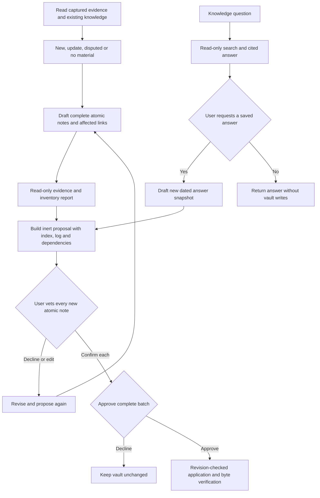

# Knowledge compilation design

The knowledge skill adapts [karpathy-llm-wiki](https://github.com/Astro-Han/karpathy-llm-wiki/tree/eafcc77001e496cc43499e4923b663aec722c813)
at revision eafcc77001e496cc43499e4923b663aec722c813. The review covered all 16 tracked files:
the skill, README, four reference templates, five example files, evidence script, its tests,
license, ignore rules and the image. Upstream code was read, not executed. Its performance claims
are not chrysalis measurements. The adapted procedure and literal-checking algorithm retain the
[MIT notice](../resources/notices/karpathy-llm-wiki.LICENSE.txt).

| Upstream approach | chrysalis implementation |
|---|---|
| Raw captures plus compiled topic articles | Sources plus in-vault originals and single-thesis Slipbox notes |
| New/update/disputed/no-material triage | Same selective compilation with user-reviewed note boundaries |
| Locate figures/dates/quotes before writing | Same procedure plus portable read-only payload-fidelity lint |
| Broad article reuse and cross-topic links | Reuse the same thesis; explain concept links and exact project associations |
| Cascade inspection and outdated/disputed blocks | Complete proposed affected notes/links with dates, reasons and both-source provenance |
| Index-first plus full-text query | Index plus full-body literal/token/alias search; compact paged results and selected reads |
| Saved query archive | Explicit new dated System answer snapshot with cited note revisions/content fingerprints |
| Article index and append-only log | Reviewed System knowledge index and log; backend preserves journal prefixes |
| Automatic mechanical lint fixes | Read-only findings followed by individually scoped, reviewed repairs |
| Host skill instructions govern compilation | Native per-new-note review plus batch approval enforced by the portable backend |

The upstream evidence checker compares high-signal literal spellings against raw body text.
It excludes metadata/code and status blocks; presence is not a fact check. chrysalis checks only
captured source payloads, retains checks for figures/quoted claims in status explanations, decodes
escaped payload text once, and binds observed source/knowledge revisions to the proposal. Dates
attached to status markers remain bookkeeping. Unknown extraction coverage remains explicit.
WikiLink destinations are excluded from literal checking; visible aliases still participate.
Captured text is normalized once, empty captures count as unavailable, and checks share a 64 MiB
cumulative scan budget plus 100,000-comparison cap, with explicit incomplete-check findings on
exhaustion. No-material decisions bind specific source revisions.
Neither implementation proves atomicity, entailment, contradiction resolution or source authority.

The portable core has no new service, database, embedding dependency or host SDK requirement.
Skills load the compilation and query/maintenance references only as needed. Concise search results
can reduce unnecessary context loading, but no token or answer-quality benchmark has been run.
The added approval work deliberately takes user attention. Comparable or better model-produced
knowledge needs separate synthetic/model acceptance; implementation coverage alone cannot prove it.

Storage remains shallow and bounded. Individual index/log records cap at 1 MiB and proposals at
4 MiB/500 records. Inspection fails on scan limits rather than silently dropping knowledge.
The journal and index need a future paged design beyond these budgets. Dependency checks protect
observed records, not newly appearing files or every concurrent-editor race. Source acquisition,
factual semantic judgment and desktop rendering remain distinct acceptance boundaries.

Fresh vaults receive empty index/log records and the expanded Zettel schema. Existing vaults are
not resource-upgraded by installing this package revision: their selected schemas remain authoritative.
knowledge.prepare can propose missing index/log records, but schema adoption needs separate reviewed
resource work outside the life profile. No personal vault was changed for this implementation.
