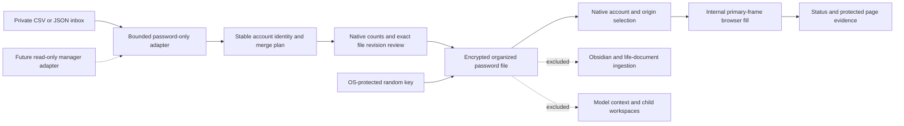

# Saved passwords for browser use

Vault onboarding explicitly offers an optional private CSV/JSON password-export inbox. Choose
Later or Skip to continue without it. Return with `/chrysalis passwords setup`. This folder is
separate from life documents, source and Obsidian; password exports are never roadmap evidence.

Place an unencrypted UTF-8 export in the displayed inbox, then run `/chrysalis passwords import`.
Supported inputs include common CSV columns (`name`, `url`, `username`, `password`), Bitwarden CSV
login columns and Bitwarden unencrypted JSON login items. Generic JSON arrays use `name`, `url`
or `urls`, `username`, `password` and optional `folder`/`externalId`. Encrypted manager exports,
cards, notes, passkeys and TOTP seeds are not imported. Only public HTTPS browser origins qualify;
HTTP, known private-address literals, local names and application URLs are skipped. Domain names
are resolved and checked for public addresses by the browser transport at use time; import makes
no DNS requests. Input limits are 2 MiB and 5,000 records.

Native review shows additions, updates, unchanged/skipped items and the resulting count. Matching
accounts keep their local IDs; new accounts append. Manager IDs are preferred when available,
otherwise normalized origin and username identify a match. Missing accounts are retained. Ambiguous
duplicates stop the import; resolve them in the manager or use an export with stable item IDs.
The source export and current encrypted file are checked again before applying. No plaintext
proposal or recovery copy is written. After successful import, a separate native choice can remove
the exact plaintext input. Deletion does not erase external backups or guarantee secure erasure.

The organized `passwords.encrypted.json` lives in the selected vault's external execution state,
under its private `passwords` directory. Its decrypted records are sorted by folder, origin and
username. AES-256-GCM protects the complete record collection; a random encryption key is protected
by the OS account. Windows and accepted WSL use Windows CurrentUser DPAPI. Native Linux uses Secret
Service; macOS uses Keychain. Unavailable protection or corrupt data stops use without a plaintext
fallback. Native Linux/macOS backend acceptance remains separate. Trusted host code can access
credentials; the workspace runner never receives the store, key or import folder.

Enable the optional browser capability when ready. The saved-login tool asks you to select a matching
account and approve its exact HTTPS origin and target fields. It fills primary-frame username and/or
password inputs internally and returns only status. It does not click submit; trusted page input handlers may react to filling or transmit data. Subsequent clicks
and account-changing requests retain native approvals. Cross-origin requests are blocked while
credentials are in use; close the private browser before changing credential origins. Federated
cross-origin login flows may need the user-controlled visible browser.

Passwords are not returned in tool arguments/results, session memory, child briefs or credential
inventory exports. A bounded literal matcher redacts known password representations from browser text/title/links;
query strings and fragments are omitted in the protected profile. Screenshots are disabled when
saved passwords are loaded. Browser automation refuses oversized redaction dictionaries (512 KiB
of patterns or 131,072 matcher states) and page text over 1 MiB. Imports may still store larger
collections within their separate limits. These controls are not a general proof against arbitrary transformations
by a website: the exact origin receiving a password is a user-selected trusted endpoint. Recognizable
exports are refused by ordinary document copy/extraction, workspace snapshots and the source checker.

## Future password-manager sources

The private `PasswordSourceAdapter` snapshot port separates source access from canonical records,
merge/review policy, encrypted storage and browser use. A future Bitwarden adapter should use native
authentication/unlock, account-scoped stable item IDs, explicit read-only sync and shared revision
checks. Session/master-password material must stay in protected parent-side handling, outside model
context, argv, worker environments and logs. Remote deletions and local conflicts need explicit
policy; they must not silently remove or overwrite entries. Nothing installs or connects Bitwarden
today. Export formats and CLI session behavior are described in the official
[Bitwarden import format](https://bitwarden.com/help/condition-bitwarden-import/) and
[CLI documentation](https://bitwarden.com/help/cli/).

